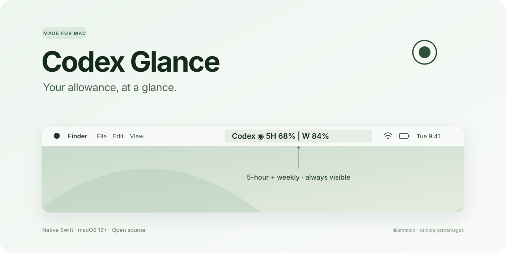

<p align="center">
  
</p>

<p align="center">
  <a href="https://github.com/taizi0125/codex-glance/releases/latest"></a>
  
  
  <a href="LICENSE"></a>
</p>

<p align="center"><b>你的 Codex 还剩多少，一眼就知道。</b><br>极简 macOS 菜单栏额度监控器。</p>
<p align="center"><a href="https://github.com/taizi0125/codex-glance/releases/latest/download/Codex-Glance-macOS.zip"><b>下载 macOS 版 ↓</b></a> · <a href="README.en.md">English</a> · <a href="https://github.com/taizi0125/codex-glance/issues">反馈问题</a></p>

---

## 为什么做它

每次写到一半，都要点开头像才能查看额度。有时只是想知道“还能用多久”，也要打断手头的工作。

于是有了 Codex Glance：把 **5 小时额度** 和 **每周额度** 直接放到 Mac 顶部菜单栏。

```text
Codex ◉ 5H 68%  |  W 84%
```

百分比表示**剩余额度**；上图为样例数据。保持简约，抬眼就能看到。

## 有什么

- **始终可见**：额度直接显示在菜单栏文字中。
- **自动刷新**：每 20 秒读取一次，并在收到 Codex 额度更新通知时刷新。
- **原生轻量界面**：Swift + AppKit，无 Dock 图标，跟随系统菜单栏外观。
- **登录时启动**：点击菜单栏文字，勾选「登录时启动」。
- **中英双语**：菜单根据系统首选语言显示中文或英文。
- **连接状态明确**：断线或数据过期时显示 `--%`，自动重连；点击可查看更新时间和重置时间。
- **本机读取**：通过已安装的 Codex 应用服务器读取当前登录账号的额度；不需要单独的 API Key。

## 安装

需要 **macOS 13 或更新版本**，支持 Apple Silicon 和 Intel。请先安装 ChatGPT / Codex 桌面端，或 Codex CLI，并登录你的 ChatGPT 账号。

1. [下载最新版 ZIP](https://github.com/taizi0125/codex-glance/releases/latest/download/Codex-Glance-macOS.zip) 并解压。
2. 把 **Codex Glance.app** 拖到「应用程序」文件夹。
3. 双击启动，菜单栏会出现额度。需要开机自启时，在它的菜单中勾选「登录时启动」。

当前安装包是本地临时签名构建，**未经过 Apple 公证**。首次打开若被 macOS 拦截，在确认下载来源后，按系统提示到「系统设置 → 隐私与安全性」允许打开。也可以按下面的步骤自行编译。

## 从源码构建

安装 Xcode Command Line Tools 后，在终端运行：

```sh
git clone https://github.com/taizi0125/codex-glance.git
cd codex-glance
bash scripts/build.sh
open 'dist/Codex Glance.app'
```

构建同时支持两种芯片的安装包：

```sh
bash scripts/package.sh universal
```

输出是 `dist/Codex-Glance-macOS.zip`，附带 `SHA256SUMS.txt` 校验值。代码和构建脚本不包含任何个人账号、登录令牌或本机路径。

## 工作原理与隐私

Codex Glance 会启动本机已有的 `codex app-server --stdio`，通过 `account/rateLimits/read` 获取额度，并接收额度更新通知。它使用 Codex 已有的登录状态，不单独读取、保存或上传登录令牌。

应用没有自建服务器、埋点或分析服务，也不读取你的聊天内容。额度查询由本机 Codex 与 OpenAI 通信完成，需要联网。默认安装版每 20 秒查询一次；额度的实际更新时间由服务端决定。

这是独立的社区项目，与 OpenAI 无隶属关系。Codex 应用服务器接口仍可能变化；若升级后读取失败，欢迎提交 Issue。

## 常见问题

**显示 `--%`？**

确认 ChatGPT / Codex 已登录，并检查网络。如果 CLI 还未登录，可在终端运行 `codex login`。某个窗口未由服务端返回时，该项也会显示 `--%`。点击菜单栏文字可查看连接状态。

**看不到菜单栏文字？**

Mac 刘海屏或菜单栏图标较多时，系统可能因空间不足隐藏项目。尝试减少其他图标，或用菜单栏整理工具腾出空间。

**只想看重置时间？**

点击菜单栏文字即可查看，时间按照本机时区显示。

**旧版「Codex额度监控器」用户怎么升级？**

先退出旧版，并在「系统设置 → 通用 → 登录项」移除旧版，再启动 Codex Glance。两者是独立应用，避免同时运行造成重复显示。

**卸载？**

取消勾选「登录时启动」，退出应用，然后将 Codex Glance.app 移到废纸篓。

## 开发与反馈

欢迎 [提交问题](https://github.com/taizi0125/codex-glance/issues) 和 Pull Request。开发检查、数据接口排查方法见 [CONTRIBUTING.md](CONTRIBUTING.md)。推送 `v*` 标签后，GitHub Actions 会构建通用安装包并发布 Release。

[MIT License](LICENSE) · 如果它让你少点了一次头像，欢迎点个 Star。
